# Aplikacja TODO — dokumentacja

Stan dokumentacji: **20 października 2026 r.**

Aplikacja służy do zarządzania własnymi zadaniami i projektami. Frontend jest napisany w React, backend korzysta z Symfony 7.4 i PDO, a logowanie obsługuje Keycloak. Dane aplikacji znajdują się w MySQL, natomiast konta i konfiguracja Keycloak w osobnej bazie PostgreSQL.

Dokumentacja opisuje aktualne pliki repozytorium. Konfiguracja już działającego Keycloak może różnić się od pliku importu.

## Spis treści

- [Funkcje aplikacji](#funkcje-aplikacji)
- [Technologie](#technologie)
- [Adresy stron](#adresy-stron)
- [Logowanie, sesja i MFA](#logowanie-sesja-i-mfa)
- [Uruchomienie przez Docker](#uruchomienie-przez-docker)
- [Keycloak i import realm](#keycloak-i-import-realm)
- [Struktura projektu](#struktura-projektu)
- [Baza aplikacji](#baza-aplikacji)
- [API](#api)
- [Praca lokalna i sprawdzanie zmian](#praca-lokalna-i-sprawdzanie-zmian)
- [Rozwiązywanie problemów](#rozwiązywanie-problemów)
- [Ograniczenia aktualnej wersji](#ograniczenia-aktualnej-wersji)

## Funkcje aplikacji

### Zadania

- Dodawanie zadania z nazwą, opisem, terminem, priorytetem i statusem.
- Przypisywanie zadania do własnego projektu podczas dodawania i edycji.
- Opcja „Brak” zapisuje zadanie bez projektu (`project_id = NULL`).
- Wyświetlanie zadań zalogowanego użytkownika wraz z nazwą projektu.
- Edycja danych zadania.
- Usuwanie zadania po zaakceptowaniu okna potwierdzenia.

Priorytety: **Niski**, **Normalny**, **Wysoki**. Statusy: **Do zrobienia**, **Realizowane**, **Wykonane**.

W formularzach i na listach daty są wpisywane i wyświetlane w formacie `dd-MM-yyyy` (komponent `DateInput.jsx`, funkcje pomocnicze w `utils/date.js`). API przyjmuje format `YYYY-MM-DD`.

<p align="center">
  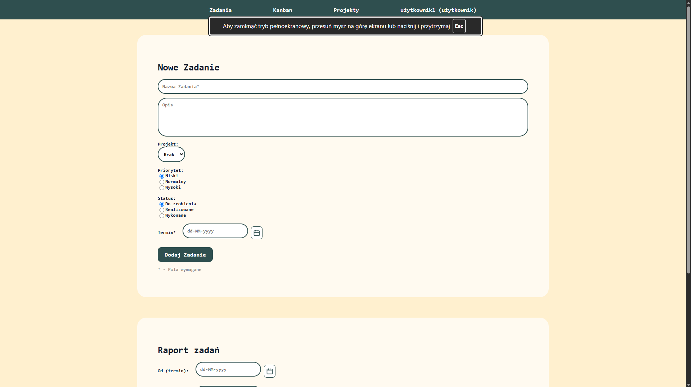
  <br>
  <em>Widok zadań — formularz dodawania nowego zadania (nazwa, opis, projekt, priorytet, status, termin).</em>
</p>

<p align="center">
  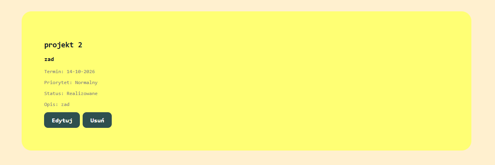
  <br>
  <em>Karta zadania na liście: nazwa projektu, termin, priorytet, status, opis oraz przyciski „Edytuj” i „Usuń”.</em>
</p>

### Kanban

Widok `/kanban` pokazuje własne zadania w trzech kolumnach: **Do zrobienia** (czerwonej), **Realizowane** (żółtej), **Wykonane** (zielonej). Zmiana statusu jest dostępna wyłącznie przez select na karcie. Widok jest zaimplementowany w `Kanban.jsx` (style w `Kanban.css`).

Zmiana jest zapisywana automatycznie. W trakcie zapisu karta jest zablokowana, a błąd przywraca jej poprzedni status i wyświetla komunikat. Karty pokazują nazwę projektu, nazwę i opis zadania, termin oraz priorytet. Tablica korzysta z istniejących zadań i nie wymaga zmiany schematu bazy.

<p align="center">
  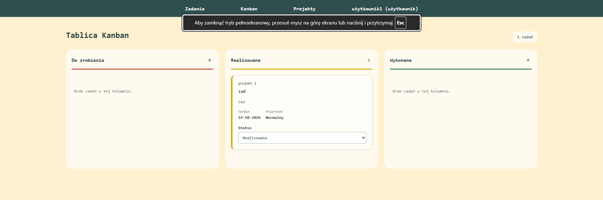
  <br>
  <em>Tablica Kanban — zadania w kolumnach „Do zrobienia”, „Realizowane” i „Wykonane”.</em>
</p>

### Projekty

- Tworzenie projektu z nazwą i opcjonalnym opisem.
- Lista własnych projektów i przypisanych do nich zadań.
- Wykres kołowy przedstawiający podział zadań według statusu.
- Edycja nazwy oraz opisu projektu.
- Usuwanie projektu razem ze wszystkimi jego zadaniami po potwierdzeniu.

Backend sprawdza właściciela projektu. Usunięcie zadań i projektu odbywa się w jednej transakcji: błąd powoduje wycofanie operacji. Okno potwierdzenia jest elementem interfejsu, a kontrola dostępu działa niezależnie po stronie API.

<p align="center">
  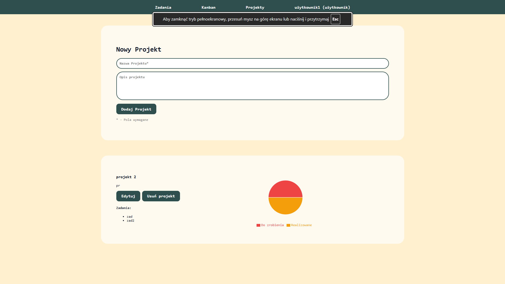
  <br>
  <em>Widok projektów — formularz nowego projektu, lista zadań projektu i wykres kołowy statusów.</em>
</p>

### Raporty

Panel raportów znajduje się na stronie zadań. Umożliwia pobranie raportu **PDF** lub **CSV** oraz podgląd wygenerowanego PDF w przeglądarce.

Raport zawiera nazwę zadania, projekt, termin, priorytet, status i opis. Zakres dat dotyczy **terminu zadania**, a nie daty jego utworzenia. Granice zakresu są włączone. Pusta granica nie ogranicza zakresu z tej strony. Zadania bez terminu są pomijane. Raport powstaje w przeglądarce na podstawie już pobranej listy zadań. Logika filtrowania zadań do raportu znajduje się w `reportFilters.js` i jest objęta testem `reportFilters.test.js`.

<p align="center">
  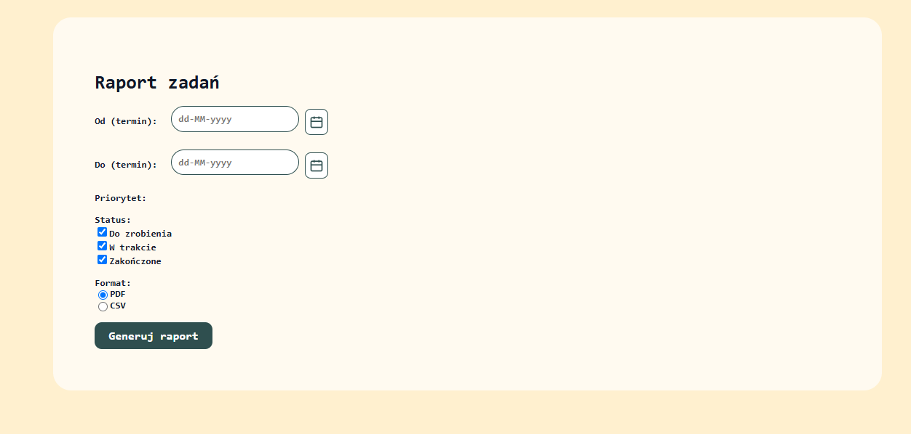
  <br>
  <em>Panel „Raport zadań” — zakres terminów, priorytet, status i format (PDF / CSV).</em>
</p>

### Panel użytkownika

Kliknięcie nazwy użytkownika w nawigacji otwiera panel z edycją loginu, emaila, imienia i nazwiska. Osobny formularz pozwala zmienić hasło po podaniu obecnego hasła oraz potwierdzeniu nowego.

Zmiany danych są przekazywane do Keycloak i lokalnej tabeli `users`. Zmiana emaila usuwa poprzednie oznaczenie emaila jako zweryfikowanego. Hasła użytkowników nie są przechowywane w MySQL aplikacji.

Widok administracyjny jest dostępny dla roli `admin`, ale komponent `Users.jsx` zawiera obecnie tylko miejsce na przyszły panel zarządzania użytkownikami.

<p align="center">
  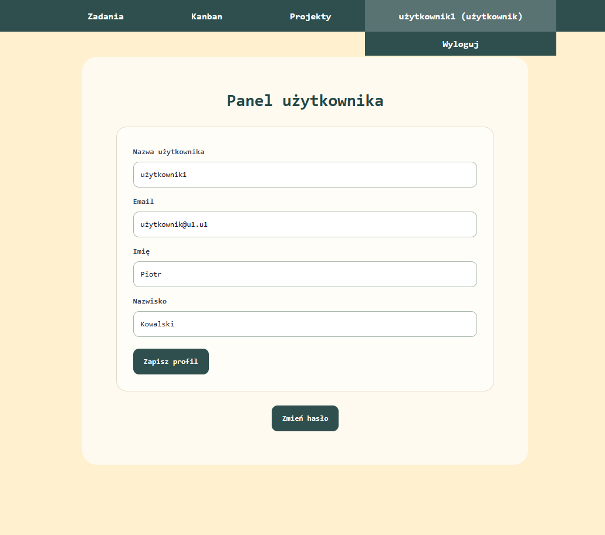
  <br>
  <em>Panel użytkownika — edycja loginu, emaila, imienia i nazwiska oraz przycisk „Zmień hasło”. W menu dostępne jest „Wyloguj”.</em>
</p>

<p align="center">
  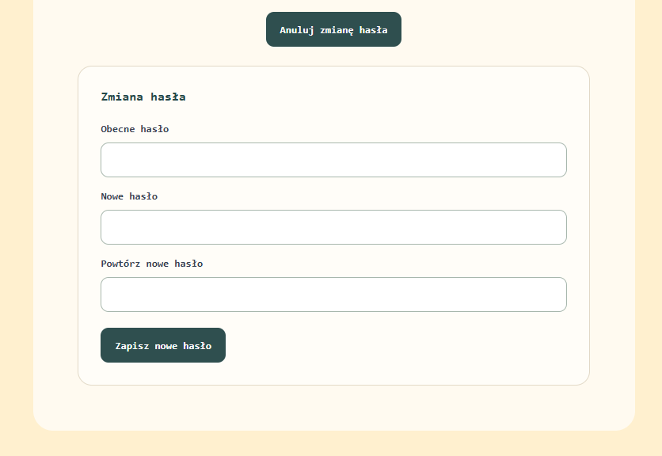
  <br>
  <em>Formularz zmiany hasła — obecne hasło, nowe hasło i jego potwierdzenie.</em>
</p>

## Technologie

| Warstwa              | Rozwiązanie                                    |
| -------------------- | ---------------------------------------------- |
| Interfejs            | React 19, React Router 7, Vite 8               |
| Żądania HTTP         | Axios i wspólna funkcja `apiFetch`             |
| Wykresy              | Recharts                                       |
| Raporty              | pdfmake, PDF.js (`pdfjs-dist`)                 |
| Backend              | Symfony 7.4, PHP 8.3 w Dockerze                |
| Baza aplikacji       | MySQL 8.4, PDO                                 |
| Konta i logowanie    | Keycloak 26.0.8, OpenID Connect, `keycloak-js` |
| Baza Keycloak        | PostgreSQL 16                                  |
| Weryfikacja JWT      | `firebase/php-jwt`                             |
| Serwowanie frontendu | Nginx                                          |
| Podgląd bazy         | phpMyAdmin                                     |
| Środowisko           | Docker Compose                                 |

Dokładne wersje zależności zapisane są w plikach `composer.lock` i `package-lock.json`.

## Adresy stron

| Adres              | Widok                                        |
| ------------------ | -------------------------------------------- |
| `/tasks`           | Zadania i raporty                            |
| `/kanban`          | Tablica zadań ze zmianą statusu przez select |
| `/projects`        | Projekty                                     |
| `/panel`           | Panel użytkownika                            |
| `/admin`, `/users` | Widok administracyjny z kontrolą uprawnień   |

Adresy `/`, `/index` i `/index.html` przekierowują do `/tasks`. Adres `/usermenu` przekierowuje do `/panel`. Przekierowania React działają po zakończeniu logowania i ustanowieniu sesji aplikacji.

Interfejs startuje w `main.jsx`, a widoki aplikacji obsługują `App.jsx` i `AuthenticatedApp.jsx` (ten drugi odpowiada za część dostępną po zalogowaniu). Dawny plik `BffApp.jsx` nie istnieje już w repozytorium.

## Logowanie, sesja i MFA

1. `main.jsx` uruchamia klienta Keycloak w trybie `login-required` z PKCE S256.
2. Po logowaniu frontend przekazuje tokeny do `POST /auth/session`.
3. Backend sprawdza token dostępu, token ID, zgodność użytkownika oraz wymaganie MFA. Rejestruje użytkownika w lokalnej bazie i odnawia identyfikator sesji.
4. Tokeny są zapisywane w sesji backendu. Przeglądarka korzysta dalej z ciasteczka **`TODOSESSID`**, oznaczonego jako HttpOnly i SameSite=Lax.
5. Odpowiedź sesji zawiera token CSRF. `api.js` dodaje go jako `X-CSRF-Token` do żądań zmieniających dane. Backend sprawdza również nagłówek `Origin`.
6. Backend odświeża token dostępu przy użyciu tokenu odświeżania. Wylogowanie unieważnia sesję aplikacji i przekierowuje do wylogowania Keycloak.

API korzysta obecnie z sesji. Sam nagłówek `Authorization: Bearer ...` nie zastępuje zalogowanej sesji. Tokeny są jednak dostępne w pamięci przeglądarki podczas inicjalizacji przez `keycloak-js`; aplikacja nie realizuje całego logowania wyłącznie po stronie serwera.

### Ekrany logowania i rejestracji

Przy pierwszym wejściu na aplikację użytkownik jest przekierowywany do strony logowania Keycloak.

<p align="center">
  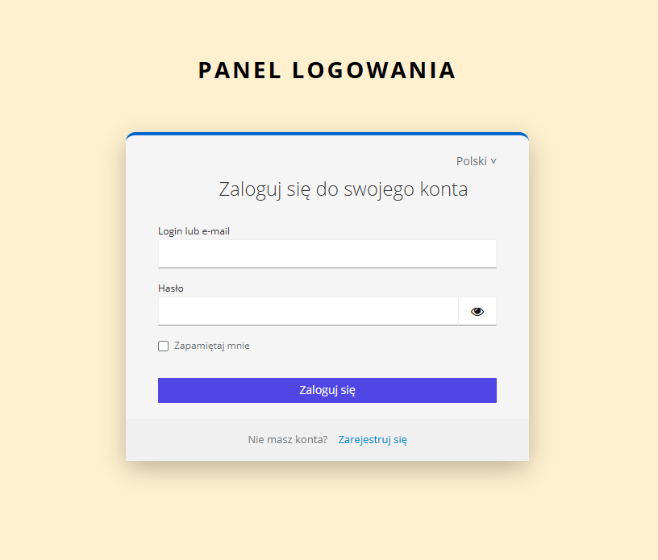
  <br>
  <em>Panel logowania — pierwszy krok: login lub e-mail, hasło oraz link do rejestracji.</em>
</p>

<p align="center">
  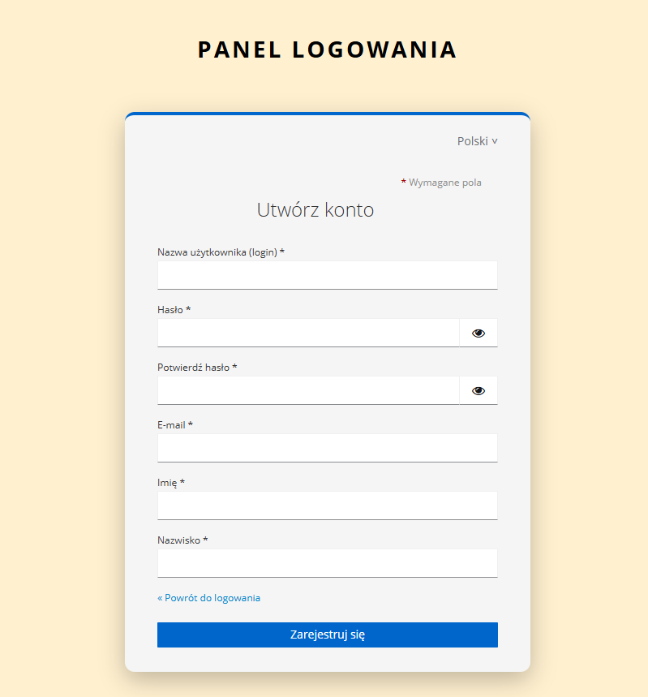
  <br>
  <em>Formularz tworzenia konta — login, hasło (z potwierdzeniem), e-mail, imię i nazwisko.</em>
</p>

<p align="center">
  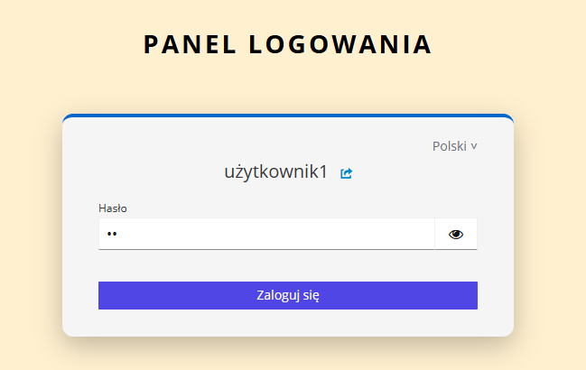
  <br>
  <em>Logowanie — krok podania hasła dla wybranego użytkownika.</em>
</p>

### Konfiguracja i weryfikacja MFA

Przy pierwszym logowaniu Keycloak wymaga skonfigurowania aplikacji uwierzytelniającej (Microsoft Authenticator, Google Authenticator lub FreeOTP): należy zeskanować kod QR, a następnie wpisać wygenerowany kod jednorazowy i opcjonalnie nazwę urządzenia. Przy kolejnych logowaniach wymagany jest już tylko kod jednorazowy.

<p align="center">
  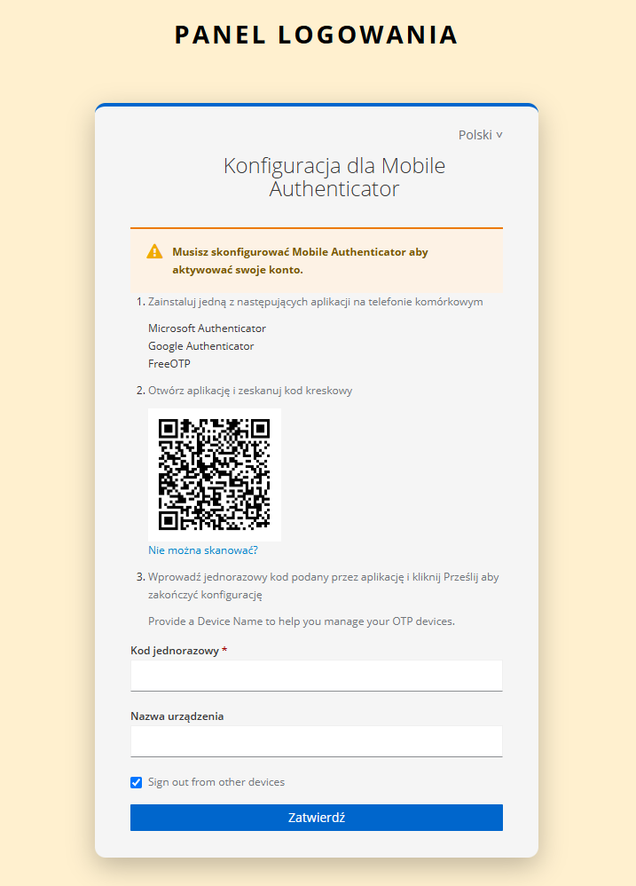
  <br>
  <em>Pierwsze logowanie — konfiguracja Mobile Authenticator (kod QR, kod jednorazowy, nazwa urządzenia).</em>
</p>

<p align="center">
  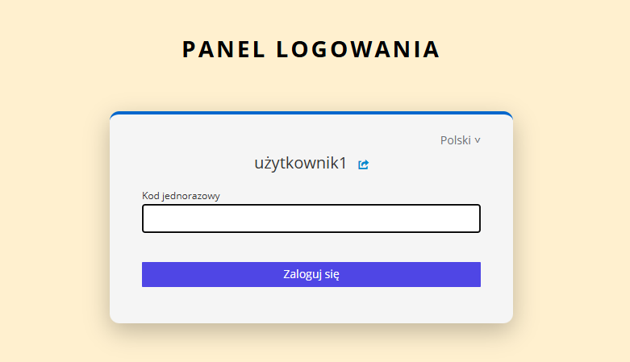
  <br>
  <em>Kolejne logowania — podanie kodu jednorazowego z aplikacji uwierzytelniającej.</em>
</p>

Jeśli backend nie potwierdzi dodatkowego uwierzytelnienia (odpowiedź 403 podczas ustanawiania sesji), interfejs wyświetla ekran ponownej weryfikacji MFA:

<p align="center">
  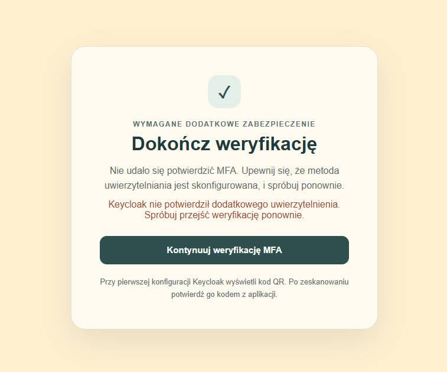
  <br>
  <em>Ekran „Dokończ weryfikację” — przycisk „Kontynuuj weryfikację MFA” ponawia przejście przez uwierzytelnianie w Keycloak.</em>
</p>

### Obecne wymaganie MFA

Backend wymaga dodatkowego uwierzytelnienia: akceptowanego `acr` z `KEYCLOAK_MFA_ACR_VALUES` lub jednej z wartości `amr`: `otp`, `mfa`, `hwk`, `swk`. Domyślne wymagane ACR to `2`. Przy odpowiedzi 403 podczas ustanawiania sesji interfejs wyświetla ekran ponownej weryfikacji MFA.

Aktualny plik realm zawiera standardowy przepływ `browser`, formularz hasła oraz warunkowy krok OTP. Warunkowy OTP nie oznacza, że każde konto automatycznie spełnia wymagania backendu. Konfiguracja Keycloak musi rzeczywiście zapewniać wymaganą metodę uwierzytelnienia i odpowiednie informacje w tokenie. Samo ustawienie zmiennej ACR nie konfiguruje MFA.

Usunięte rozszerzenie Java `todo-email-otp` nie jest częścią aktualnego obrazu Keycloak. Nie należy mylić dawnych kodów email ze standardowym OTP z aplikacji uwierzytelniającej. Pozostałe pliki szablonów email OTP nie uruchamiają samodzielnie tej funkcji.

## Uruchomienie przez Docker

Wymagane są Docker z obsługą Linux containers i Docker Compose. Polecenia wykonuj w głównym katalogu projektu.

### 1. Konfiguracja środowiska

Jeśli nie masz jeszcze `.env`, skopiuj przykład:

```powershell
Copy-Item .env.example .env
```

Nie nadpisuj istniejącego `.env`, jeśli zawiera konfigurację działających baz. Ustaw własne hasła oraz długi losowy `APP_SECRET`. Nie umieszczaj rzeczywistych sekretów w repozytorium.

| Zmienna                                         | Przeznaczenie                                                    |
| ----------------------------------------------- | ---------------------------------------------------------------- |
| `APP_DB_NAME`, `APP_DB_USER`, `APP_DB_PASSWORD` | Baza aplikacji i jej użytkownik                                  |
| `APP_DB_ROOT_PASSWORD`                          | Hasło administratora MySQL przy inicjalizacji                    |
| `KC_DB_USER`, `KC_DB_PASSWORD`                  | Użytkownik bazy PostgreSQL Keycloak                              |
| `KC_ADMIN_USER`, `KC_ADMIN_PASSWORD`            | Administrator Keycloak; używany też przez backend do edycji kont |
| `APP_SECRET`                                    | Sekret Symfony                                                   |
| `FRONTEND_ORIGIN`                               | Adres aplikacji, domyślnie `http://localhost:3000`               |
| `COOKIE_SECURE`                                 | `false` dla lokalnego HTTP; przy HTTPS ustaw `true`              |
| `KEYCLOAK_PUBLIC_URL`                           | Adres Keycloak dostępny z przeglądarki                           |
| `KEYCLOAK_REALM`                                | Realm aplikacji, domyślnie `todo-app`                            |
| `KEYCLOAK_CLIENT_ID`                            | Klient, domyślnie `todo-frontend`                                |
| `KEYCLOAK_ISSUER`                               | Issuer, domyślnie `http://localhost:8081/realms/todo-app`        |
| `KEYCLOAK_MFA_ACR_VALUES`                       | Akceptowane ACR; obecny przykład wymaga `2`                      |

Compose ustawia wewnętrzny `KEYCLOAK_URL=http://keycloak:8080` oraz dane połączenia `DB_DSN`, `DB_USER`, `DB_PASSWORD`. `CORS_ALLOW_ORIGIN` pochodzi z `FRONTEND_ORIGIN`. Zmienne `VITE_*` są przekazywane podczas budowania frontendu, więc ich zmiana wymaga przebudowy obrazu.

### 2. Sprawdzenie montowania `db/init.sql`

Repozytorium **nie zawiera pliku `db/init.sql`**. Jeśli `docker-compose.yml` nadal montuje `./db/init.sql` do `/docker-entrypoint-initdb.d/init.sql`, Docker może utworzyć w jego miejscu pusty katalog zamiast pliku SQL, co przeszkadza w inicjalizacji MySQL.

Przed pierwszym uruchomieniem usuń tę linię montowania z własnej konfiguracji albo dodaj rzeczywisty plik SQL. Backend potrafi sam utworzyć brakujące tabele, więc import danych nie jest do tego wymagany. Skrypty inicjalizacyjne obrazu MySQL dotyczą pierwszej inicjalizacji wolumenu, nie każdego restartu.

### 3. Start

```bash
docker compose up -d --build
```

| Usługa      | Adres                   |
| ----------- | ----------------------- |
| Aplikacja   | <http://localhost:3000> |
| API Symfony | <http://localhost:8080> |
| Keycloak    | <http://localhost:8081> |
| phpMyAdmin  | <http://localhost:8082> |
| MySQL       | `localhost:3306`        |

Aktualny Compose nie uruchamia Mailpit. Reset hasła przez link jest wyłączony w pliku realm, a działającej wysyłki email nie należy zakładać bez osobnej konfiguracji SMTP.

Nginx przekazuje `/api/` i `/auth/` do backendu, dzięki czemu frontend i API są dostępne dla przeglądarki pod jednym originem. Pozostałe adresy obsługuje React.

### 4. Przebudowa i logi

```bash
docker compose up -d --build frontend
docker compose up -d --build backend
docker compose logs --tail=100 backend
docker compose logs --tail=100 keycloak
docker compose exec backend php bin/console debug:router
docker compose exec backend php bin/console app:database:init
```

Po przebudowie frontendu odśwież stronę przez Ctrl+F5. W obecnym Compose montowany jest tylko `backend/public`; zmiany `backend/src`, `backend/config`, zależności i Dockerfile wymagają przebudowy backendu.

```bash
docker compose down
```

Zwykłe `down` zachowuje nazwane wolumeny baz. **Opcja `-v` je usuwa.** Nie jest potrzebna do zwykłego restartu lub aktualizacji aplikacji. Zmiana hasła w `.env` nie zmienia automatycznie hasła użytkownika w już zainicjalizowanej bazie.

## Keycloak i import realm

Compose importuje wyłącznie `keycloak/todo-app-realm.json`. `keycloak/realm-export.json` jest osobnym eksportem i nie jest obecnie montowany jako plik importu.

Importowany realm zawiera klienta aplikacji, role, przykładowe konta i konfigurację przepływów logowania. Nie oznacza to importu projektów i zadań do MySQL.

Wygląd stron logowania zapewnia motyw `keycloak-themes/todo-theme` (komunikaty w języku polskim i angielskim oraz własne style). Skrypt PowerShell `keycloak/configure-otp-amr.ps1` służy do konfiguracji OTP/AMR w Keycloak.

`start-dev --import-realm` nie aktualizuje automatycznie istniejącego realm. Zmiana pliku JSON i restart mogą więc nie zmienić logowania zapisanego w PostgreSQL. Istniejącą konfigurację należy aktualizować przez panel administratora lub Admin API, zachowując konta. Po usunięciu rozszerzenia Java trzeba osobno sprawdzić, czy zapisany przepływ nadal nie odwołuje się do brakującego providera.

Zmiana nazwy użytkownika zależy również od ustawienia Keycloak **Realm settings → Login → Edit username**. Backend do edycji kont potrzebuje poprawnych danych administratora oraz jego uprawnień. Sprawdzanie obecnego hasła korzysta z klienta `admin-cli` w realm aplikacji i musi być zgodne z jego konfiguracją; dodatkowe wymagania OTP mogą wpływać na ten przepływ.

## Struktura projektu

```text
backend/
  bin/console
  config/
    bootstrap.php
    bundles.php
    routes.yaml
    services.yaml
    services_test.yaml
    packages/
      framework.yaml
      test/framework.yaml
  src/
    Kernel.php
    Controller/
      AuthController.php
      AccountController.php
      TaskController.php
      ProjectController.php
    Repository/TodoRepository.php
    Service/
      Keycloak.php
      Input.php
      ConnectionFactory.php
      Schema.php
    Command/InitializeDatabaseCommand.php
    EventSubscriber/ApiSubscriber.php
  public/
    index.php
    router.php
    edittasks.php
    index.php.old
  tests/
    integration.php
    kanban_status.php
  .dockerignore
  .env.dist
  composer.json
  composer.lock
  Dockerfile
frontend/
  public/
    favicon.svg
    icons.svg
  src/
    main.jsx
    App.jsx
    AuthenticatedApp.jsx
    api.js
    keycloak.js
    App.css
    index.css
    theme.css
    assets/
    components/
      DateInput.jsx
      DateInput.css
    pages/
      Home.jsx
      Kanban.jsx
      Kanban.css
      Projects.jsx
      Profile.jsx
      UserMenu.jsx
      UserMenu.css
      Users.jsx
      ReportPanel.jsx
      reportFilters.js
      reportFilters.test.js
    utils/
      date.js
  index.html
  nginx.conf
  vite.config.js
  package.json
  package-lock.json
  .oxlintrc.json
  Dockerfile
keycloak/
  todo-app-realm.json
  realm-export.json
  configure-otp-amr.ps1
keycloak-themes/
  todo-theme/login/
    messages/
      messages_pl.properties
      messages_en.properties
    resources/css/styles.css
    theme.properties
docs/
  images/            # zrzuty ekranu używane w dokumentacji
docker-compose.yml
.env.example
.gitignore
composer.json
composer.lock
package.json
package-lock.json
server.js
README.md
```

- Kontrolery obsługują żądania i odpowiedzi JSON.
- `TodoRepository` zawiera zapytania PDO oraz kontrolę właściciela zasobów.
- `Input` sprawdza dane JSON, długości pól, identyfikatory i daty.
- `Keycloak` obsługuje weryfikację tokenów, sesję, MFA i Admin API.
- `ApiSubscriber` obsługuje CORS i błędy API.
- `Schema` i `ConnectionFactory` obsługują inicjalizację bazy.

Pliki `Profile.jsx` i `theme.css` pozostają w repozytorium, ale nie tworzą aktualnego głównego widoku. Stare samodzielne endpointy `addtasks.php`, `showtasks.php`, `deletetasks.php` i `addprojects.php` zostały zastąpione trasami Symfony. W `backend/public/` pozostały jeszcze `edittasks.php` i `index.php.old`; nie są częścią obecnego API.

## Baza aplikacji

| Tabela     | Kolumny                                                                                                      |
| ---------- | ------------------------------------------------------------------------------------------------------------ |
| `users`    | `id`, `keycloak_id`, `username`, `first_name`, `last_name`, `email`, `role`, `created_at`, `last_login`      |
| `projects` | `id`, `name`, `description`, `user_id`                                                                       |
| `tasks`    | `id`, `name`, `description`, `deadline`, `created`, `updated`, `priority`, `status`, `user_id`, `project_id` |

Powiązania:

- `users.id` — liczbowy identyfikator z `AUTO_INCREMENT` i unikalnym indeksem.
- `users.keycloak_id` — tekstowy identyfikator Keycloak i klucz główny tabeli.
- `tasks.user_id` — liczbowy `users.id`.
- `projects.user_id` — tekstowy `users.keycloak_id`, zabezpieczony kluczem obcym.
- `tasks.project_id` — identyfikator projektu albo `NULL`; schema nie definiuje tu klucza obcego, a poprawność przypisania sprawdza backend.

`AUTO_INCREMENT` może pozostawiać luki i nie służy do numerowania kolejnych pozycji na liście.

Backend przy starcie kontenera wykonuje `app:database:init`. Przy połączeniu `ConnectionFactory` dodatkowo sprawdza obecność trzech tabel i uzupełnia brakujące. Przy błędzie nieistniejącej bazy MySQL próbuje ją utworzyć, co wymaga odpowiednich uprawnień użytkownika MySQL.

Nowe tabele są puste. Lokalne konto użytkownika jest dodawane podczas ustanawiania sesji lub pierwszego pobrania profilu. Istniejące dane nie są czyszczone. Inicjalizacja uzupełnia wybrane starsze kolumny `users`, ale nie jest pełnym systemem migracji. Backend korzysta z PDO, nie z Doctrine ORM.

## API

Żądania aplikacji są kierowane przez Nginx na porcie 3000. Wymagają aktywnej sesji. Operacje zmieniające dane wymagają również prawidłowego `Origin` i `X-CSRF-Token`, poza ustanawianiem sesji, które ma własną weryfikację originu.

| Metoda | Adres                    | Działanie                                                                      |
| ------ | ------------------------ | ------------------------------------------------------------------------------ |
| POST   | `/auth/session`          | Weryfikacja tokenów i ustanowienie sesji                                       |
| GET    | `/auth/me`               | Informacje o sesji i token CSRF                                                |
| POST   | `/auth/logout`           | Unieważnienie sesji i uzyskanie adresu wylogowania Keycloak                    |
| GET    | `/api/me`                | Pobranie lokalnego profilu, rejestracja konta przy pierwszym użyciu            |
| PUT    | `/api/me`                | Zmiana loginu, emaila, imienia i nazwiska                                      |
| PUT    | `/api/me/password`       | Zmiana hasła                                                                   |
| GET    | `/api/tasks`             | Lista własnych zadań                                                           |
| POST   | `/api/tasks`             | Dodanie zadania                                                                |
| PUT    | `/api/tasks/{id}`        | Edycja własnego zadania, w tym projektu                                        |
| PUT    | `/api/tasks/{id}/status` | Zmiana wyłącznie statusu własnego zadania; JSON zawiera `status` z pełną nazwą |
| DELETE | `/api/tasks/{id}`        | Usunięcie własnego zadania                                                     |
| GET    | `/api/projects`          | Lista własnych projektów                                                       |
| POST   | `/api/projects`          | Dodanie projektu                                                               |
| PUT    | `/api/projects/{id}`     | Edycja nazwy i opisu projektu                                                  |
| DELETE | `/api/projects/{id}`     | Usunięcie projektu i jego zadań                                                |
| GET    | `/api/admin`             | Sprawdzenie roli administratora                                                |

Przykład danych projektu:

```json
{
  "name": "Praktyki",
  "description": "Zadania do wykonania podczas praktyk"
}
```

Przykład danych zadania:

```json
{
  "name": "Przygotować dokumentację",
  "description": "Opisać aktualne działanie aplikacji",
  "deadline": "2026-10-20",
  "priority": "Normalny",
  "status": "Do zrobienia",
  "project_id": null
}
```

API zadań przyjmuje `description` lub starsze pole `desc`. Priorytet i status mogą mieć pełną nazwę albo indeks od zera w podanych wcześniej listach. Nazwa zadania i projektu ma maksymalnie 100 znaków. Data musi być poprawna i mieć format `YYYY-MM-DD`. Pominięcie `project_id` przy edycji zachowuje dotychczasowe przypisanie; `null` je usuwa.

Błędy mają postać `{"error":"komunikat"}`. Typowe kody to 400 dla błędnych danych, 401 dla brakującej lub wygasłej sesji, 403 dla braku MFA, uprawnień lub nieprawidłowej ochrony CSRF, 404 dla brakującego albo niedostępnego zasobu oraz 500/502/503 dla błędów serwera lub usług. Szczegóły techniczne należy sprawdzać w logach backendu.

## Mobile mock API

Run `npm run mock:api` from the repository root, then in another terminal run `cd mobile` and `npm start`. The mobile app loads tasks from `mock/data/db.json` and saves new or edited tasks through json-server. The API is available at `http://localhost:3001/tasks` on the computer.

The app detects the computer address from Expo's development server. If it cannot, Android Emulator falls back to `http://10.0.2.2:3001`, while iOS Simulator and web fall back to `http://localhost:3001`. For a physical phone, keep it and the computer on the same network. If needed, copy `mobile/.env.example` to `mobile/.env`, uncomment `EXPO_PUBLIC_API_URL`, and set it to the computer's LAN IP, such as `http://192.168.1.10:3001`.

## Praca lokalna i sprawdzanie zmian

Do pracy poza Dockerem potrzebne są PHP co najmniej 8.2, Composer, rozszerzenia wymagane przez pakiety Symfony, PDO MySQL, dostępny MySQL i Keycloak. Testy korzystają dodatkowo z PDO SQLite. Frontend wymaga Node.js zgodnego z Vite; obraz używa Node.js 22.

```bash
cd backend
composer install
```

Backend ładuje `backend/.env`, a gdy go nie ma — `backend/.env.dist`. Obecny `.env.dist` nie zawiera wszystkich zmiennych nowszej obsługi sesji. Przy pracy lokalnej trzeba dopisać co najmniej `COOKIE_SECURE`, `FRONTEND_ORIGIN` i `KEYCLOAK_MFA_ACR_VALUES`, a także skonfigurować bazę, Keycloak oraz sekret. Poza Dockerem te wartości nie są automatycznie pobierane z głównego `.env` przez Compose.

```bash
php bin/console debug:router
php bin/console lint:container
php bin/console lint:yaml config
php bin/console app:database:init
php -S localhost:8080 -t public public/router.php
```

Frontend:

```bash
cd frontend
npm ci
npm run build
npm run lint
npm run dev
```

Vite używa portu 3000 i przekazuje `/api` oraz `/auth` do `http://localhost:8080`. Dla lokalnego uruchamiania ustaw zmienne frontendu `VITE_KEYCLOAK_URL`, `VITE_KEYCLOAK_REALM` i `VITE_KEYCLOAK_CLIENT_ID`; opcjonalne `VITE_KEYCLOAK_MFA_ACR` domyślnie wynosi `2`.

### Obecny stan testów

Uruchom `npm test` z katalogu głównego, aby wykonać testy logiki frontendu, walidacji nazw i opisów, walidację backendu oraz produkcyjny build frontendu. Testy jednostkowe sprawdzają filtry raportów, statystyki, białe znaki, limity znaków i znaki Unicode. Wymagane są Node.js i PHP.

`php backend/tests/kanban_status.php` sprawdza kontroler zmiany statusu i repozytorium na SQLite: dozwolone statusy, zachowanie pozostałych danych, błędne dane i kontrolę właściciela. Używa testowej tożsamości i nie zastępuje testu sesji ani logowania na rzeczywistym Keycloak.

W repozytorium jest skrypt `backend/tests/integration.php` oparty na SQLite i zastępczym kliencie HTTP Keycloak. Obejmuje operacje zadań i projektów, kontrolę właściciela oraz wycofanie transakcji przy błędzie usuwania projektu.

**Skrypt nadal wysyła token Bearer, a aktualne API używa sesji i CSRF.** Nie jest więc obecnie pełnym, dostosowanym testem aktualnego logowania. Może również zatrzymać się na brakujących zmiennych środowiskowych. Wcześniejszych wyników testów nie należy traktować jako potwierdzenia działania obecnej wersji uwierzytelniania.

Testy nie uruchamiają MySQL, Keycloak ani przeglądarki; te integracje nadal wymagają sprawdzenia osobno.

### Sprawdzenie ręczne

1. Zaloguj się i przejdź wymagane MFA.
2. Sprawdź, czy wejście na `/` kończy się pod `/tasks`.
3. Dodaj projekt, zmień jego nazwę i opis, a następnie anuluj inną edycję.
4. Dodaj zadania z projektem i bez projektu; sprawdź też zmianę projektu podczas edycji.
5. Anuluj usunięcie zadania i upewnij się, że pozostało na liście; następnie potwierdź usunięcie.
6. Usuń projekt z zadaniami po potwierdzeniu i sprawdź, czy inne zadania pozostały.
7. Zaloguj się na inne konto i sprawdź odrębność zasobów.
8. Wygeneruj PDF i CSV dla zakresu terminów.
9. Sprawdź zmianę danych profilu, zmianę hasła i wylogowanie.

## Rozwiązywanie problemów

| Objaw                          | Co sprawdzić                                                                                                          |
| ------------------------------ | --------------------------------------------------------------------------------------------------------------------- |
| Błąd 500 API                   | `docker compose logs --tail=100 backend`, połączenie z bazą i inicjalizację tabel                                     |
| Brak tabel                     | `docker compose exec backend php bin/console app:database:init` i uprawnienia MySQL                                   |
| Ekran wymagający MFA           | Konfigurację OTP, claimy `acr`/`amr` i mapery klienta w Keycloak                                                      |
| „Nieprawidłowe dane logowania” | Konto, hasło i aktualny przepływ w istniejącym realm; sam log `invalid_user_credentials` nie wyjaśnia całej przyczyny |
| Błąd usuniętego providera      | Pozostały krok `todo-email-otp` w zapisanej konfiguracji Keycloak                                                     |
| Błąd 403 przy zapisie          | Sesję, CSRF, origin oraz dostęp do zasobu                                                                             |
| Zmiany interfejsu niewidoczne  | Przebudowę frontendu i odświeżenie Ctrl+F5                                                                            |
| Błąd profilu lub hasła         | Konfigurację Admin API, administratora, klienta `admin-cli` oraz wymagania uwierzytelniania konta                     |

## Ograniczenia aktualnej wersji

- Panel zarządzania użytkownikami nie jest zaimplementowany.
- Aktualny backend wymaga MFA, a spójność tej konfiguracji z działającym realm wymaga osobnego sprawdzenia.
- Zmiana profilu obejmuje Keycloak i MySQL bez wspólnej transakcji między tymi systemami.
- Nazwa w nawigacji może wymagać ponownego logowania po zmianie profilu.
- Reset hasła przez email jest wyłączony w pliku importu realm.
- Testy uwierzytelniania wymagają aktualizacji do sesji i CSRF.
- PHP działa na serwerze deweloperskim, a Keycloak w trybie `start-dev`; to konfiguracja do pracy lokalnej.
- Repozytorium nie zawiera pliku `db/init.sql`; montowanie go w `docker-compose.yml` wymaga uporządkowania przed inicjalizacją nowego środowiska.

Przy tej aktualizacji dokumentacji nie uruchamiano pełnego środowiska Docker ani testu logowania na rzeczywistym Keycloak. Zmieniony został wyłącznie plik dokumentacji.
